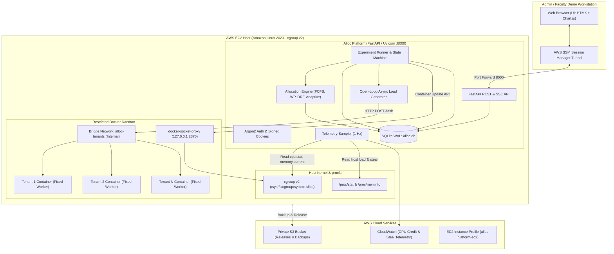

# System Architecture

## 1. Architectural Overview

The Adaptive Multi-Tenant Cloud Resource Allocation Platform compares resource allocation algorithms on real containers running on an AWS EC2 instance. All client and administrative interactions occur locally through an encrypted AWS Systems Manager (SSM) Session Manager tunnel.

## 2. Core Subsystems

### 2.1 Allocator Subsystem (`src/alloc_platform/allocator/`)
- **`types.py`**: Immutable dataclasses (`Tenant`, `Pool`, `TenantObs`, `Plan`).
- **`validate.py`**: Strict parameter boundary validation and guarantee feasibility checks.
- **`fcfs.py`**: Deterministic First-Come First-Served baseline.
- **`proportional.py`**: Weighted Proportional allocation with iterative water-filling.
- **`drf.py`**: Weighted Dominant Resource Fairness with progressive filling.
- **`adaptive.py`**: Online convex optimizer maximizing log-utility with pseudo-Huber churn penalty, dynamic demand estimation, surplus CPU harvesting, and hysteresis stability filtering.
- **`metrics.py`**: Pure statistical and fairness metric functions (Jain's index, bottleneck satisfaction, bootstrap CI).
- **`simulator.py`**: Fluid model offline test simulator (all outputs strictly tagged `SIMULATED`).

### 2.2 Enforcement Subsystem (`src/alloc_platform/enforcement/`)
- Connects to Docker daemon exclusively via `tecnativa/docker-socket-proxy` at `tcp://127.0.0.1:2375`.
- Creates and maintains the isolated `alloc-tenants` bridge network.
- Creates tenant containers with fixed non-root worker image, read-only rootfs, dropped capabilities, no host mounts, and PID limits.
- Dynamically applies CPU quota (`cpu.cfs_quota_us`) and memory limit (`memory.max` with swap disabled) via container update API.
- Reads back cgroup v2 nodes to verify kernel limits.
- Automatically cleans up orphaned containers on startup and experiment termination.

### 2.3 Telemetry Subsystem (`src/alloc_platform/telemetry/`)
- Samples container cgroup v2 stats (`cpu.stat`, `memory.current`, `memory.max`) at 1.0 Hz.
- Measures delta CPU usage, throttling percentage, and memory consumption.
- Samples host `/proc/stat` and `/proc/meminfo` for CPU steal percentage and memory pressure.
- Queries CloudWatch for burstable CPU credit balance where applicable.
- All recorded data rows carry the strict provenance tag `MEASURED`.

### 2.4 Workload Subsystem (`src/alloc_platform/workload/`)
- **Worker Image (`worker/`)**: Minimal Python 3.11 service exposing `POST /task` with SHA-256 CPU burn and allocated bytearray memory hold. Bounded queue with HTTP 429 backpressure.
- **Traces (`traces.py`)**: Scripted open-loop Poisson arrival generators with burst multipliers.
- **Load Generator (`loadgen.py`)**: Async HTTP client (`httpx.AsyncClient`) dispatching requests at scheduled timestamps to eliminate coordinated omission.

### 2.5 Orchestrator Subsystem (`src/alloc_platform/orchestrator/`)
- Asynchronous finite state machine (`IDLE` $\rightarrow$ `PREPARING` $\rightarrow$ `WARMUP` $\rightarrow$ `RUNNING` $\rightarrow$ `COOLDOWN` $\rightarrow$ `CLEANUP` $\rightarrow$ `DONE`).
- Enforces mutual exclusion via single-row database lock and `asyncio.Lock` (maximum 1 experiment per host).
- Wall-clock watchdog and cancellation events ensure safe termination.

### 2.6 Persistence Subsystem (`src/alloc_platform/db/`)
- SQLAlchemy 2.0 with SQLite in Write-Ahead Logging (`WAL`) mode.
- Busy timeout set to 5000 ms to avoid locking collisions.
- Stores environment, experiments, runs, raw samples, derived metrics, and audit logs.

### 2.7 API & Web UI Subsystem (`src/alloc_platform/api/`)
- FastAPI application with OpenAPI documentation.
- Server-Sent Events (`GET /events`) stream real-time allocation updates and metrics.
- Jinja2 server-rendered templates styled with accessible modern CSS.
- HTMX for dynamic content swaps without heavy single-page application complexity.
- Chart.js vendored locally to eliminate external CDN dependencies.
- Provenance badges visible on every displayed number.
